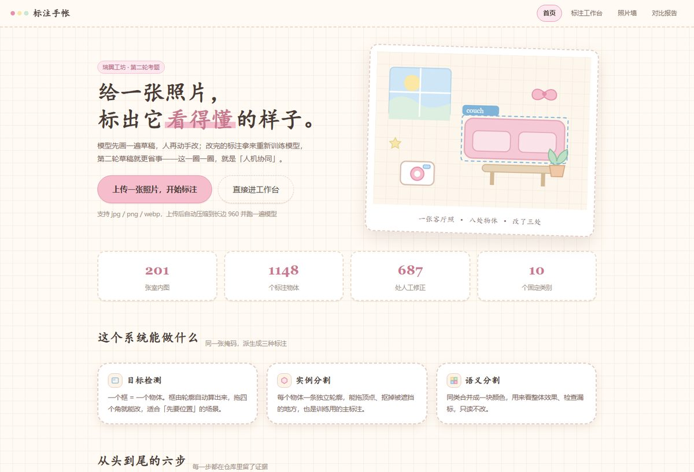
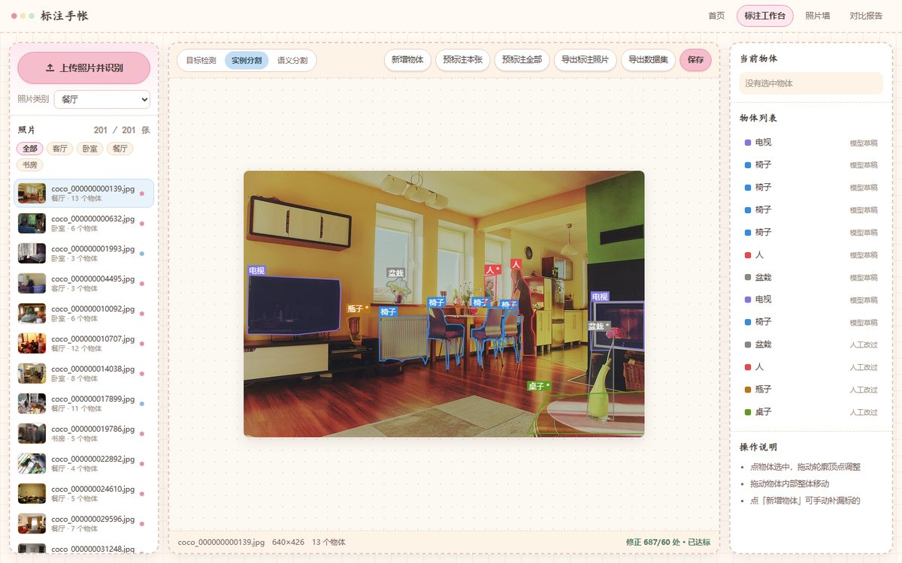
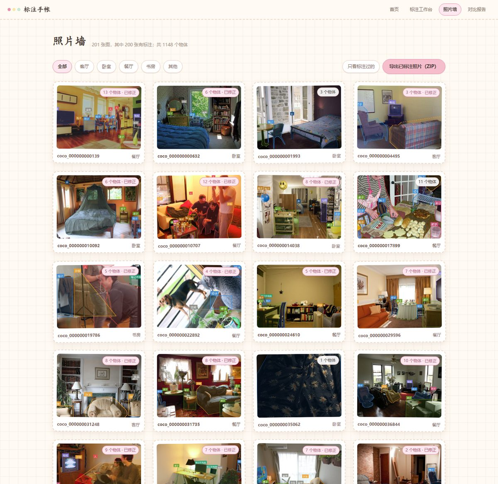
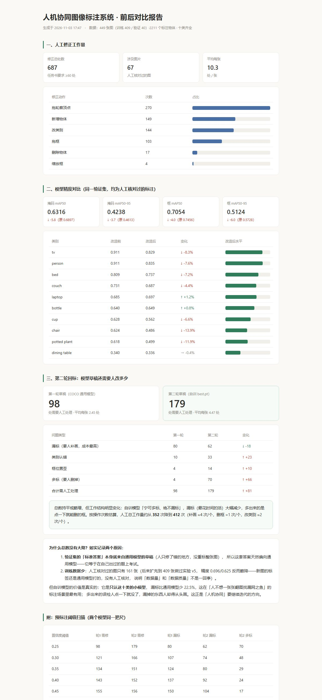

# 人机协同图像标注系统

一个本地运行的网页工具：模型先画出标注草稿，人用鼠标把草稿改准，改完的数据导出成标准数据集，
再拿去训练，训练好的模型回来重新预标注 —— 一轮比一轮准。

十类物体（顺序固定，不得更改）：
`person` 人 / `chair` 椅子 / `dining table` 桌子 / `couch` 沙发 / `tv` 电视 /
`laptop` 笔记本 / `cup` 杯子 / `bottle` 瓶子 / `potted plant` 盆栽 / `bed` 床

---

## 一、怎么运行

**方式 A：双击（推荐）**

双击 `启动.bat`。它会自动激活 `imglabel` 环境并打开浏览器 `http://127.0.0.1:5000`。
第一次运行若弹出「Windows 已保护你的电脑」，点「更多信息 → 仍要运行」。

**方式 B：命令行**

```
conda activate imglabel
cd /d D:\imglabel
python app.py
```

浏览器打开 `http://127.0.0.1:5000`。

**四个常用开关**

```
python app.py --model model/best.pt   # 改用自己训的模型做预标注（第二轮）
python app.py --conf 0.4              # 预标注置信度阈值：误检多就调高，漏标多就调低（默认 0.25）
python app.py --lan                   # 允许同一 WiFi 下的手机/别的电脑访问，会打印局域网地址
python app.py --port 5001             # 5000 被占用时换端口
```

**四个页面**

| 地址 | 页面 | 干什么 |
|---|---|---|
| `/` | 封面 | 介绍 + 一排真实数字 + 「上传一张照片，开始标注」 |
| `/workbench` | 标注工作台 | 三模式画布、预标注、拖拽修正、导出数据集 |
| `/gallery` | 照片墙 | 所有标过的照片（标注已画在图上），按类别筛，可导出 |
| `/compare` | 对比报告 | 改造前后精度、第二轮回标结果（`records/compare.html`） |






**界面上的按钮**

| 按钮 | 作用 |
|---|---|
| 上传照片并识别（左栏最上面，粉色大按钮） | 选一张新照片（手机拍的也行），先选「照片类别」，上传后自动压缩到长边 960 并立刻跑模型识别 |
| 导出标注照片 | 把标注画在照片上，连同名 json 一起打包成 `标注照片.zip` 下载 |
| 预标注本张 / 预标注全部 | 用当前模型给已有图片画草稿 |
| 导出数据集 | 把标注导出成 YOLO 数据集（检测 + 分割 + 两种掩码） |
| 照片类别（下拉框） | 客厅 / 卧室 / 餐厅 / 书房 / 其他；照片墙按它筛选 |

## 二、环境依赖

```
conda create -n imglabel python=3.10 -y
conda activate imglabel
pip install -r requirements.txt -i https://pypi.tuna.tsinghua.edu.cn/simple
```

无独立显卡亦可运行（CPU 训练），首次启动会自动下载模型权重。

## 三、目录说明

| 路径 | 作用 |
|---|---|
| `app.py` | Flask 服务端：图片列表、标注读写、预标注、修正记账、导出 |
| `prelabel.py` | 模型预标注：图片 → 类别 + 轮廓（框由轮廓外接矩形派生） |
| `export.py` | 导出标准数据集（det / seg 两套标签 + 两种掩码 + 训练配置） |
| `train.py` | 训练模型，产出 `model/best.pt` |
| `fetch_coco.py` | 从 COCO val2017 批量下载**含十类物体的室内图**（按标注筛选，非随机） |
| `prelabel_all.py` | 批量预标注：给 `data/raw` 里每张图生成一份草稿，不用开网页 |
| `classes.yaml` | 十类词表 + COCO 编号映射（**全流程唯一的类别顺序来源**） |
| `canvas/` | 网页界面：`cover.html`（封面）/ `index.html`（工作台）/ `gallery.html`（照片墙）+ 样式与脚本 |
| `canvas/scrapbook.css` | 全站风格（手帐风）：颜色、虚线卡片、胶带、按钮 |
| `screenshots/` | 界面截图（README 与答辩用） |
| `data/raw/` | 原始图片（只放图，不放别的） |
| `data/preview/` | 预标注结果可视化 |
| `records/drafts/` | 模型草稿（json） |
| `records/annotations/` | 人工确认后的标注 |
| `records/fixes.jsonl` | 修正流水账，一条一行，只追加不覆盖 |
| `model/` | 训练产物 best.pt |
| `启动.bat` | 双击启动 |

## 四、三种标注模式的关系

只维护**一份实例掩码数据**，另外两种模式由它派生：

- 目标检测 = 掩码的外接矩形
- 实例分割 = 掩码本身
- 语义分割 = 同类掩码按类别合并上色

因此界面上真正需要手工编辑的只有「轮廓」这一件事。

## 五、导出数据集

在界面上点 **「导出数据集」**，或在命令行执行 `python export.py`。产物在 `D:\imglabel\dataset\`：

```
dataset\
  images\train|val\        原图
  labels\train|val\        检测标签  cls cx cy w h（0~1）
  seg\images\train|val\    原图（与上面同一批图，训练时靠目录配对）
  seg\labels\train|val\    分割标签  cls x1 y1 x2 y2 ...
  masks\train|val\         实例掩码 PNG（0=背景，1~N=第几个物体）
  semantic\train|val\      语义掩码 PNG（0=背景，1~10=类别号+1）
  data.yaml                检测训练配置
  seg\data.yaml            分割训练配置
  classes.txt / instances.json / export_report.json
```

要点：

- **训练/验证固定 8:2**，随机种子写死（`--seed 42`），每次导出划分结果一致，结果可复现
- 图片少于 2 张时没有验证集，`val` 自动指向训练集，只适合快速跑通流程
- 同一份标注出两套标签：`labels/` 是外接框（检测用），`seg/labels/` 是多边形（分割用）
- 掩码图也可以肉眼看：`data/preview/export/` 里是按类别上色的语义图
- 导出会先清空旧产物，不会把上次的图混进来

命令行参数：`--val-ratio 0.15`（验证集比例）、`--only-human`（只导人工改过的）。

## 六、训练模型

数据导出之后，在 Miniforge Prompt 里：

```
conda activate imglabel
cd /d D:\imglabel
python train.py
```

默认参数：实例分割、40 轮、尺寸 512、批量 4、初始学习率 0.0015、纯 CPU。
跑完会把最好的权重自动拷到 `model/best.pt`（加 `--no-copy` 则不覆盖，用于对比实验）。

> ⚠️ 踩过的坑：ultralytics 默认初始学习率是 **0.01**，那是给几万张图准备的。
> 本项目只有 200 张图，用 0.01 训 30 轮会把 COCO 预训练权重冲坏 —— 实测漏标从 86 处涨到 154 处、
> 多标从 10 处涨到 100 处，比原模型还差。改成 0.0015 + 余弦退火后恢复正常。
> 这就是小数据集微调和"从零训练"最大的区别。

常用参数：

```
python train.py --epochs 60        # 更久（150 张图建议 40~80 轮）
python train.py --imgsz 640        # 更准，但慢一倍
python train.py --batch 2          # 内存吃紧时调小
python train.py --task det         # 只练检测框（快，但没有轮廓）
```

训练日志和曲线在 `runs/<这次的名字>/`，其中 `results.png`、`confusion_matrix.png` 可以直接放进汇报里。

**第二轮（用自己训的模型重新预标注）**：

```
python app.py --model model/best.pt
```

这样界面上「预标注」用的就是新模型，同一批图再标一遍，对比修正条数是否减少。

> 注意：`train.py` 会先检查训练集张数。不足 20 张时会警告——那种情况下训出来的模型没有实用价值，只能验证流程能跑通。

## 七、数据从哪来

`fetch_coco.py` 从 COCO val2017 里按**标注**挑图，不是随机下：

1. 只从官方 zip 里按字节范围取出 `instances_val2017.json`（约 6MB），不下载 250MB 整包
2. 过滤：必须含十类中的**家具**（椅子/桌子/沙发/电视/盆栽/床）且占画面 ≥4%
3. 排除：食物占比 ≥8% 的餐桌特写、杯盘堆满的桌面、出现 ≥2 个车辆/红绿灯的街景
4. 按「家具面积 × 家具种类 × 是否客厅卧室」打分，贪心挑选保证每类 ≥15 张
5. 多线程下载（COCO 单连接限速约 12KB/s，靠并发叠加），统一压到长边 960 / 质量 85

结果：**461 张室内图，十类齐全**（导出后统计：人 600 / 椅子 373 / 餐桌 158 / 沙发 192 / 电视 169 / 笔记本 109 / 杯子 192 / 瓶子 186 / 盆栽 125 / 床 107 个物体，共 2211 个）

其中 40 张图划入验证集并**锁定不变**（`records/val_split.txt`），后来扩充的 260 张图全部进训练集，保证前后几次训练的 mAP 在同一套标准答案上可比。

> 注意 COCO 标注 json 里的 `category_id` 和 ultralytics 内部的 0~79 编号**不是一套**：
> 前者 chair=62、couch=63，后者 chair=56、couch=57。`fetch_coco.py` 用自己的映射表，`classes.yaml` 用 ultralytics 的。

## 八、当前进度

- [x] 环境搭建（Miniforge + imglabel + ultralytics/torch/flask）
- [x] 模型预标注打通（yolo26n-seg / YOLO-World 均可运行）
- [x] 多页网页：封面 / 标注工作台 / 照片墙 / 对比报告（手帐风格，纯 CSS 断网可用）
- [x] 画布界面：三模式切换、点选物体、拖顶点、拖框、改类别、增删、修正记账
- [x] 现场上传照片：先选类别 → 压缩入库 → 即时识别（`/api/upload`）
- [x] 导出：YOLO 数据集（txt / 实例掩码 / 语义 PNG）+ 标注照片 ZIP
- [x] 数据采集：461 张室内图（COCO 按类筛选 + 多线程下载，验证集 40 张锁定不变）
- [x] 批量预标注：449 份草稿、2211 个物体，十类全覆盖
- [x] 人工修正：67 张图共 687 处（任务书要求 ≥60 处）
- [x] 基线评估 + 两轮训练（v2/v3/v4/v5）+ 第二轮回标对比 + 阈值扫描
- [x] 对比报告页（`records/compare.html`，含如实的原因分析）
- [ ] 答辩演示与最终交付（见 `答辩演示.md`）

**第二轮的关键数字**（同一批 40 张人工核对图、同一尺寸 640 评估）：

| 指标 | 基线（COCO 通用模型） | 第二轮（自训 best.pt） |
|---|---|---|
| 框 mAP50 | 0.746 | 0.705 |
| 掩码 mAP50 | 0.690 | 0.632 |
| 草稿漏标 | 80 | **62（-22%）** |
| 草稿需人工处理合计 | 98 | 179 |

mAP 没有超过通用大模型——原因和后续方向如实写在对比报告页里：
验证集的答案本身就来自通用模型的草稿（它等于在自己出过的题上考试），
且人工核对过的训练数据只有 161 张。自训模型的真实价值是**漏标更少、只认这十类**，
而漏标恰恰是标注场景里人工成本最高的问题。

## 八·附、踩过的两个坑（写进报告里显得真实）

**坑一：框住了"一只猫"，不是整个沙发。**
物体被遮挡时掩码里会留一个洞，`masks.xy` 把外轮廓和洞拼成一条折线，
画出来就是"边框绕一圈、又拐进去绕着猫"。改为只取面积最大的外轮廓。

**坑二：所有框整体偏 11 像素。**
模型吐出的掩码是"补过黑边的模型输入尺寸"（原图 640×426，掩码 640×448，
上下各补 11 像素）。直接拿它取轮廓当原图坐标用，框就会整体偏移，
个别宽高比差得多的图横向也偏。改为先借 `scale_masks` 把掩码缩回原图
（自动扣掉补边）再取轮廓，坐标与 ultralytics 官方 `masks.xy` 逐像素一致。

> 这个坑是做完第一轮训练才发现的：当时模型是在"偏了 11 像素"的标签上训出来的。
> 修完后重算了 136 张纯模型草稿、纠正了 66 张人工图里 279 个"人只改类别没动几何"
> 的物体（人真拖过的 52 个、人自己新加的 151 个一个没动），再导出、再训练。

**坑三：报告里冒出 `{'person': 9.0}`。**
从 ultralytics 验证结果里提取"每个类别的 AP"时，把 `(类别号, AP值)` 两个序列写反了，
AP 被当成类别号去查名字。对调后分类别指标才正常——也正是这张表暴露出
自训模型在 chair 上掉了 13.9%（和 couch 互相认错）。

**坑四：数据多 ≠ 数据好。**
为了提精度又采了 260 张图（标签还是通用模型打的、没人工核对），训了 v5，
mAP 反而从 0.705 掉到 0.696——新数据稀释了那 161 张人工核对过的图。
这组对照实验留在了记录里（`runs/train_v5`），它说明标注系统里
"人核对过的数据"才是稀缺资源，也是人机协同的意义所在。

## 九、AI 工具使用说明

开发过程中使用了 AI 编程助手，时间、工具、用途逐条记录在 `ai_log.md`。
所有模型权重均为本机实际训练/实际运行产出，未使用任何伪造结果。
